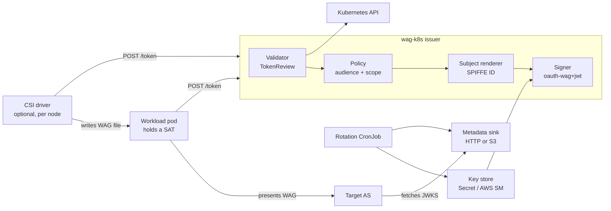

# wag-k8s: WAG issuer design

## Overview

wag-k8s is a Workload Identity Provider for one or more Kubernetes clusters: a pod trades its service account token (SAT) for a [Workload Authorization Grant](https://datatracker.ietf.org/doc/draft-carleton-workload-authz-grant/) (WAG) via RFC 8693 token exchange, and the grant's `sub` is a SPIFFE ID.

**Goals**

- RFC 8693 endpoint: `subject_token` = SAT, `requested_token_type` = `urn:ietf:params:oauth:token-type:wag`, response is a signed `oauth-wag+jwt`.
- SAT validation through the TokenReview API, not local JWKS checks.
- Publish issuer metadata and JWKS, served in-process or pushed to an external sink (S3 first).
- Pluggable signing-key storage (K8s Secret first, AWS Secrets Manager later).
- Configurable `iss`, optionally derived from an Ingress.
- Optional CSI driver that keeps a fresh WAG on disk for a pod.
- One issuer shared across several clusters.

**Non-goals for v1**

- Acting as the OAuth authorization server for the target resource (we only mint the grant).
- Delegation / on-behalf-of a user (out of scope in the spec too).
- Federation with other issuers.

## Components

One Deployment (the issuer) does all signing; the CSI driver is an optional DaemonSet that only calls the issuer; a CronJob rotates keys.



| Component | Job | v1 implementation |
| --- | --- | --- |
| Validator | Turn a SAT into an Identity | TokenReview, restricted to our SAT audience |
| Policy | Decide which audience and scopes this identity may get | ConfigMap rules, deny by default |
| Subject renderer | Build `sub` and `nickname` | Go `text/template`, SPIFFE ID incl. SA UID by default |
| Signer | Mint the `oauth-wag+jwt` | ES256 via the KeyStore's current key |
| KeyStore | Hold current, next and previous keys | K8s Secret in the issuer's namespace; AWS Secrets Manager |
| IssuerSource | Provide `iss` | Static value, or an Ingress host |
| Publisher | Put metadata + JWKS where an AS can fetch them | In-process HTTP; S3 |
| Rotation CronJob | Single writer for keys and published JWKS | `wag-k8s rotate` |
| CSI driver | Keep a fresh WAG on disk | `tokenRequests` + `requiresRepublish` |

Packaging: one Go binary with `issuer`, `csi` and `rotate` subcommands, shipped as one image and installed with a Helm chart. Kubernetes 1.30+ only.

## Interfaces

Six seams keep the core free of Kubernetes and AWS specifics; each has a K8s-native default implementation.

```go
// Who is calling, as TokenReview reports it.
type Identity struct {
    Namespace, ServiceAccount, ServiceAccountUID string
    PodName, PodUID, NodeName                   string // bound-token extras
    Extra                                       map[string][]string
}

type Validator interface { // default: TokenReview
    Validate(ctx context.Context, sat string) (*Identity, error)
}

type SubjectRenderer interface { // default: text/template -> SPIFFE ID
    Render(*Identity) (string, error)
}

type Policy interface { // who may get a WAG for which aud/scope
    Authorize(ctx context.Context, id *Identity, req ExchangeRequest) (Grant, error)
}

type KeyStore interface { // default: K8s Secret; later AWS Secrets Manager
    Load(ctx context.Context) (*KeySet, error)
    // Save is compare-and-swap on version (Secret resourceVersion, ASM VersionId).
    Save(ctx context.Context, ks *KeySet, version string) error
}

type IssuerSource interface { // static string, or read from an Ingress
    Issuer(ctx context.Context) (string, error)
}

type Publisher interface { // in-process HTTP, S3, GCS, Azure Blob
    Get(ctx context.Context, path string) (body []byte, etag string, err error)
    // Put with ifMatch="" writes unconditionally; otherwise it fails with ErrConflict
    // when the object changed, so several clusters can merge one JWKS safely.
    Put(ctx context.Context, path, contentType string, body io.Reader, ifMatch string) error
}
```

On `Publisher`: a bare `io.Writer` cannot name which document it receives, and we write at least two (`/.well-known/oauth-authorization-server` and the JWKS). A path-keyed `Put` with an `io.Reader` body keeps the streaming feel and maps 1:1 to S3 `PutObject`.

## Flows

**Token exchange** (`POST /token`)

1. Pod sends `grant_type=urn:ietf:params:oauth:grant-type:token-exchange`, `subject_token=<SAT>`, `subject_token_type=urn:ietf:params:oauth:token-type:jwt`, `requested_token_type=urn:ietf:params:oauth:token-type:wag`, `audience=<target AS issuer>`, optional `scope`.
2. Validator calls TokenReview with `spec.audiences = sat.audiences`; failure → `invalid_request` / `invalid_grant`.
3. Policy checks the identity against the requested `audience` and `scope`; denial → `invalid_target` or `invalid_scope`.
4. SubjectRenderer builds `sub` (SPIFFE ID) and `nickname`.
5. Signer issues the JWT: header `typ: oauth-wag+jwt`, `alg`, `kid`; claims `iss`, `sub`, `aud` (single value), `iat`, `exp`, `jti`, `scope`, `nickname`, plus opt-in K8s claims. `exp` = min(now + ttl, SAT `exp`).
6. Response: `access_token=<WAG>`, `issued_token_type=urn:ietf:params:oauth:token-type:wag`, `token_type=N_A`, `expires_in`.

**Metadata publishing**

1. On every KeySet change, render the metadata doc (`issuer`, `jwks_uri`, `token_endpoint`, `grant_types_supported`) and the JWKS.
2. `Put` both to every configured Publisher; the in-process server just swaps its cached copy.
3. The `issuer` in metadata must equal `iss` byte for byte (spec 6.1), so both come from the same IssuerSource.

**Key rotation**

1. A CronJob (`concurrencyPolicy: Forbid`) is the only writer of the KeyStore and the external sinks; issuer replicas only read keys.
2. Each run is idempotent and advances a phase from timestamps stored in the keyset: add a *next* key and publish it; after `overlap`, promote it to *current*; drop *previous* once it is older than `overlap` + max token TTL.
3. After any change the job pushes metadata + JWKS to external sinks; issuer replicas watch the Secret, switch to *current*, and refresh their in-process JWKS.
4. Bootstrap: a Helm hook Job (same image) creates the first key; the issuer reports not-ready until a key exists.
5. `Save` keeps compare-and-swap on `resourceVersion` as a backstop, since `Forbid` is best-effort and a manual `kubectl create job --from` can still overlap.

**CSI driver**

1. Pod mounts a `csi` volume (`driver: wag.k8s.io`, attributes: `audience`, `scope`, filename).
2. CSIDriver object sets `tokenRequests: [{audience: wag-k8s}]` and `requiresRepublish: true`, so kubelet hands the driver a fresh SAT and calls `NodePublishVolume` periodically.
3. Driver exchanges the SAT at the issuer and writes the WAG atomically (write temp + rename) into a tmpfs mount.
4. On each republish, refresh when the WAG is past ~50% of its lifetime.

## Configuration

One YAML file (ConfigMap, rendered from Helm values), every field overridable by flag. Sketch:

```yaml
cluster:
  name: prod-eu1                        # unique + immutable; used in kid and sub
issuer:
  url: https://wag.example.com          # must be https, no query/fragment (spec 5.1)
  # or derive it (single-cluster mode only):
  fromIngress: {namespace: wag-system, name: wag-issuer}  # https://<host>[/path]
sat:
  audiences: [wag-k8s]                  # SATs must be minted for us, not the API server
subject:
  # default; SA UID keeps sub unique when an SA is recreated (spec 4)
  template: "spiffe://{{ .TrustDomain }}/ns/{{ .Namespace }}/sa/{{ .ServiceAccount }}/{{ .ServiceAccountUID }}"
  trustDomain: cluster.example.com
  nicknameTemplate: "{{ .Namespace }}/{{ .ServiceAccount }}"
token:
  ttl: 5m                               # spec: SHOULD be short-lived; also capped at SAT exp
  maxTTL: 15m
keys:
  store: secret                         # secret | aws-secretsmanager
  secret: {namespace: wag-system, name: wag-signing-keys}
  algorithm: ES256
  rotateEvery: 720h
  overlap: 24h                          # publish next/previous keys this long
publish:
  mode: single                          # single | shared (multi-cluster, merged JWKS)
  serve: true                           # serve /.well-known + JWKS in-process (single only)
  sinks:
    - s3: {bucket: my-wag-issuer, prefix: ""}
policy:
  rules:                                # deny by default
    - namespaces: ["team-a"]
      audiences: ["https://as.saas.example"]
      scopes: ["issues:read"]
```

## Multi-cluster: one issuer, many clusters

Every cluster signs with its **own** key, and all public keys are merged into **one** JWKS in S3 under the shared `iss`. No private key leaves its cluster, and a compromised cluster is cut off by removing its `kid`s.

| | Shared private key | Per-cluster keys, merged JWKS (chosen) |
| --- | --- | --- |
| Private key copies | One key in every cluster | One key per cluster, stays there |
| KeyStore | One shared AWS SM secret | Per-cluster Secret or SM secret |
| Rotation writer | One designated cluster's CronJob (or SM rotation Lambda) | Each cluster's own CronJob |
| JWKS writers | One | Many: needs compare-and-swap merge |
| Revoking one cluster | Rotate everywhere | Drop that cluster's `kid`s |

**How it works**

1. Config gets `cluster.name` (unique, immutable) and `publish.mode: shared`. `iss` must be static; metadata + JWKS live in S3, typically behind CloudFront.
2. `kid` is prefixed with the cluster name (`prod-eu1/2026-10`), so writers never collide and pruning is per cluster.
3. The rotation CronJob does read-modify-write on `jwks.json` with S3 conditional writes: GET and note the ETag; replace only keys whose `kid` carries its own prefix; PUT with `If-Match: <etag>`; on 412 re-read and retry. The first write uses `If-None-Match: *`. Any writer may drop a key whose published expiry has passed.
4. Guard: refuse to write a JWKS that holds fewer foreign keys than were read. Enable bucket versioning for recovery.
5. Metadata (`/.well-known/...`) is identical for every cluster and written with `If-None-Match` once.
6. Clusters reach S3 and SM with their workload identity (EKS Pod Identity / IRSA; GKE and Azure equivalents later behind the same interfaces).

**What it changes elsewhere**

- `sub` must be unique across clusters. Templates get `{{ .Cluster }}`, and in shared mode the default becomes `spiffe://<td>/cluster/<name>/ns/<ns>/sa/<sa>/<sa-uid>`. The UID alone is already unique; the cluster name keeps the ID readable.
- Any cluster's key can sign any `sub` under the shared `iss`; that is inherent to a shared issuer and is stated in user docs.
- The in-process JWKS server is off in shared mode; issuers only read their own key.

## Decisions and open gaps

| Topic | Why it matters | Decision / proposal |
| --- | --- | --- |
| `sub` reuse | Spec 4: an Agent Identifier MUST NOT be reassigned. `ns/<ns>/sa/<sa>` is reused when an SA is deleted and recreated. | Decided: default template includes the SA UID; a plain `ns/sa` template stays possible but is documented as reusable. |
| Who may exchange (authz) | Without policy, any SA in the cluster can get a WAG for any AS. | Decided: deny by default; ConfigMap rules match namespace / SA / labels to allowed `audience` + `scope`. CRD later. |
| Audience handling | WAG `aud` must be one AS issuer. | Require `audience`, check it against the policy allowlist; reject multiple values. |
| Scope handling | `scope` is optional in WAG, and the AS decides anyway. | Pass through only scopes the policy allows; omit the claim when none requested. |
| SAT audience | Accepting default API-server SATs widens who can exchange. | TokenReview with our own audience only; CSI/projected tokens use it. |
| Lifetime and refresh | No refresh tokens for WAG; short TTL keeps a stolen grant cheap. | 5 min default, client asks again. Decided: `exp` also capped at the SAT's own `exp`. |
| Key rotation and JWKS overlap | An AS caches JWKS; S3/CDN adds its own cache. | Overlap ≥ max token TTL + publish cache TTL; set `Cache-Control` on Put. |
| HA / single writer | Two writers fork the keyset or race on S3. | Decided: rotation CronJob is the single writer; no leader election. CAS on Save as a backstop. |
| `iss` from Ingress | Any change to `iss` silently breaks every AS registration. | Read once, require TLS host, fail loudly on change; pick host via annotation. |
| Endpoint exposure | Metadata must be public; `/token` should stay in-cluster. | Two listeners/ports: public metadata, cluster-internal token endpoint. |
| RBAC | Least privilege. | Issuer: `create tokenreviews`, `get/watch` on one Secret by `resourceNames`, `get ingresses` only when enabled. Rotation job: `get/update` on that Secret only. |
| Extra K8s claims | Pod names and namespaces may be sensitive at a third-party AS. | Off by default; opt-in claim list. |
| TokenReview load | One API call per exchange. | Cache result by SAT hash until min(SAT exp, 60s). |
| Metrics and audit | Operators need to see who got what. | Prometheus counters/latency per outcome; structured audit log per grant (`sub`, `aud`, `jti`, `scope`). |
| CSI failure modes | Issuer down at pod start; expiry while issuer is unreachable. | Fail `NodePublishVolume` so kubelet retries; keep the old file until a new one lands; file mode 0440 + `fsGroup`. |
| Proof of possession | Spec open issue; WAG is a bearer grant. | Out of scope for v1, track the spec. |
| Install / versions | | Decided: Helm chart; Kubernetes 1.30+ (bound SAT extras `pod-uid`, `node-name`, `credential-id`); one image. |
